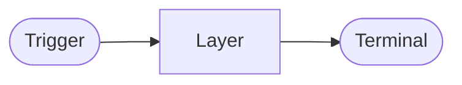
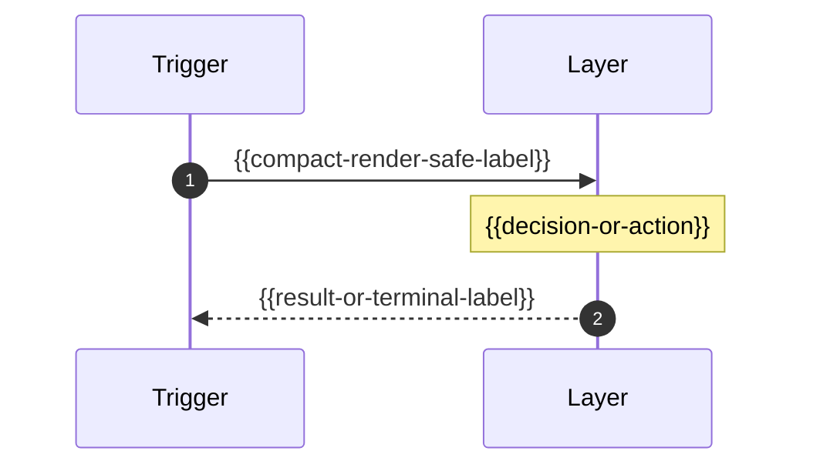
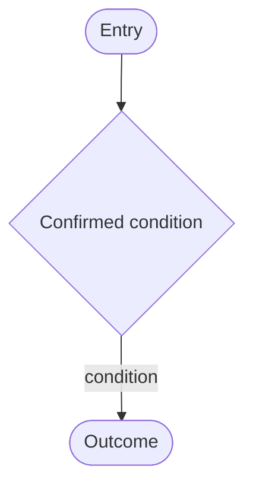

# Flow: {{feature-name}}

- **Feature:** {{feature-name}}
- **Entry point:** {{confirmed-entry-points}}

---

## Lịch sử chỉnh sửa

| Ngày | Thay đổi | Bởi |
| --- | --- | --- |
| {{date}} | {{Tạo mới hoặc Tái tạo từ code}} | generate-flow |

---

## Flow Summary

{{Tóm tắt ngắn gọn đường đi, nhánh quan trọng và kết quả.}}



| # | Bước | Mô tả |
| --- | --- | --- |
| 1 | {{bước-thực-tế}} | {{mô-tả-ngắn}} |

---

## Full Flow

### Path: {{tên-path}}

#### Nguồn code

- `{{repo-relative-path}}` — `{{symbol}}`: {{hành-vi-được-xác-nhận}}



#### Chú thích dữ liệu

<!-- Include only when shorthand or field changes need explanation. Describe decision-relevant fields and their evolution; use field: Type only inside code blocks. -->

**[alias]** `{{source}}` → `{{destination}}`:

```text
{{fieldName}}: {{Type}} // unchanged, derived, removed, newly created, or returned
```

#### Sơ đồ quyết định

<!-- Optional: include only when this path has meaningful branches. -->



---

## Điểm kết thúc

| Loại | Mô tả | File | Function |
| --- | --- | --- | --- |
| {{confirmed-terminal-or-cutoff}} | {{observed-effect-or-reason}} | `{{repo-relative-path}}` | `{{symbol}}` |

---

## Câu hỏi còn mở

<!-- Optional: include only genuine unresolved behavior, inferred shapes, or trace cutoffs. -->

- {{unresolved-question-or-cutoff}}
