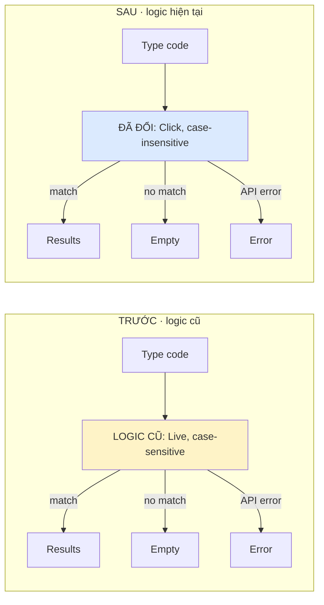

# Implementation notes — Order search (fictional)

Spec: `docs/specs/order-search.md`

## Open questions
- 51 matches: pagination is unspecified. Keep current behavior pending product confirmation (`chờ xác nhận`).

## Flow

Old: pre-change tests; current: final code.

## Decision / tradeoff
- Approved: `ab-12` matches `AB-12`; click-to-search cuts API calls but adds an action.

## Verification
- `npm test -- order-search` — 12 passed (fictional); browser not run.
