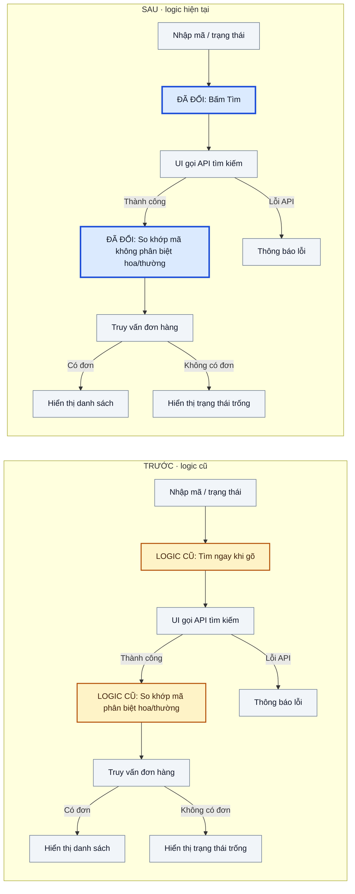

# Implementation notes — Tìm kiếm đơn hàng (ví dụ giả định)

> Ví dụ minh họa; đường dẫn, quyết định và kết quả kiểm thử dưới đây không thuộc một task thật.

**Spec/yêu cầu:** `docs/specs/order-search.md` — tìm đơn hàng theo mã và trạng thái.

**Phạm vi hiện tại:** Bộ lọc theo mã và trạng thái trong trang danh sách đơn hàng.

## Câu hỏi còn mở

- **Có cần giới hạn số kết quả?** Khi 51 đơn hàng khớp bộ lọc, spec chưa nói phải hiển thị 51 đơn hay phân trang. Chưa triển khai giới hạn 50; cần người phụ trách sản phẩm chốt hành vi trước khi thêm giới hạn.

## Sơ đồ triển khai

Nút vàng `LOGIC CŨ` cho thấy tìm khi gõ và so khớp mã phân biệt hoa/thường; nút xanh `ĐÃ ĐỔI` cho thấy hành vi thay thế; nút xám là bước giữ nguyên. Trong kịch bản giả định, luồng cũ được đối chiếu với phiên bản trước của `src/orders/page.tsx` và `src/orders/search.ts`, luồng mới với phiên bản sau; quy tắc cho hơn 50 kết quả còn chờ xác nhận.

## Quyết định khi spec chưa rõ

- **Tìm mã đơn hàng không phân biệt chữ hoa/thường:** Người dùng thường nhập lại mã bằng tay. **Trạng thái quyết định:** Đã chốt trong yêu cầu cập nhật giả định. **Đối chiếu:** `docs/specs/order-search.md`, `src/orders/search.ts`.

## Ví dụ hành vi

| Tình huống/đầu vào | Kết quả mong đợi | Nguồn |
|---|---|---|
| Nhập `ab-12` khi có đơn `AB-12` | Tìm thấy đơn `AB-12` | `docs/specs/order-search.md`, `tests/order-search.test.ts` |
| 51 đơn khớp bộ lọc | Chờ xác nhận: hiển thị hết hay phân trang | Chưa có tiêu chí chấp nhận hoặc test |

## Thay đổi so với yêu cầu

- **Yêu cầu gốc:** Tìm kiếm ngay khi gõ. **Thực tế:** Chỉ tìm khi bấm nút. **Lý do:** Giảm số lần gọi API. **Trạng thái:** Trong kịch bản giả định, người yêu cầu đã chấp thuận; `docs/specs/order-search.md` và test đã được cập nhật.

## Tradeoff

**Đã chọn:** Tìm khi bấm nút để giảm số request, theo yêu cầu cập nhật giả định.

| Phương án | Lợi ích | Chi phí/rủi ro |
|---|---|---|
| Tìm khi gõ | Phản hồi nhanh | Nhiều request; cần xử lý kết quả về sai thứ tự |
| Tìm khi bấm nút | Ít request, dễ kiểm soát | Thêm thao tác cho người dùng |

## Kiểm chứng

- `npm test -- order-search` — 12/12 test pass trong kịch bản giả định, gồm case `ab-12`; dùng dữ liệu giả, chưa có case 51 đơn.
- Tìm kiếm qua browser — chưa chạy trong kịch bản giả định vì chưa có môi trường thử nghiệm.

## Thông tin khác cần biết

- Chưa kiểm tra dữ liệu lớn và hành vi khi nhiều người cùng cập nhật đơn hàng.
- Khi người phụ trách sản phẩm chốt quy tắc cho 51 đơn, cập nhật spec, test, code và note cùng nhau.
