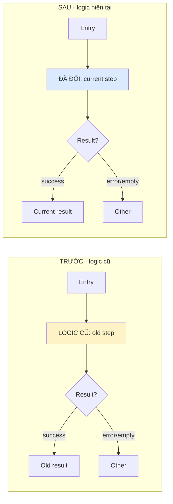

# Implementation notes — [Task]

Spec: [Link]
Scope: [Change]

## Open question
- **[Q]:** [Case, unknown, impact, confirmer; `chờ xác nhận`]

## Flow

Cite pre-change old and final current code; say if old is unverified.

## Decisions
- [Decision + reason.] **Status:** [Approved/source or `chờ xác nhận`]. **Evidence:** [Links relative to this note]

**Example:** [Input → outcome; source]

## Deviations / tradeoffs (optional)
- [Difference/approval; chosen option vs alternative cost]

## Verification
- `[Command]` — [Result/limits]
