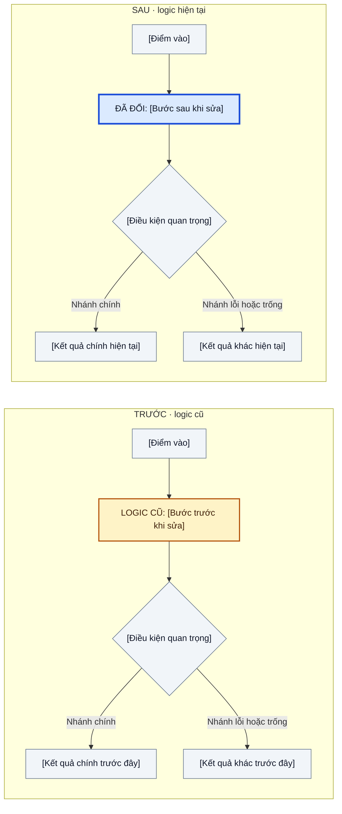

# Implementation notes — [Tên task]

**Spec/yêu cầu:** [Đường dẫn hoặc mô tả yêu cầu]

**Phạm vi hiện tại:** [Một câu về phần đã làm; cập nhật khi triển khai thay đổi]

## Câu hỏi còn mở

- **[Câu hỏi]:** [Tình huống cụ thể, kết quả chưa rõ, ảnh hưởng và người cần xác nhận. Nếu không có, bỏ mục này.]

## Sơ đồ triển khai

[Thay scaffold bằng luồng cũ và luồng hiện tại đầy đủ trong phạm vi thay đổi. Nút `LOGIC CŨ` màu vàng, `ĐÃ ĐỔI` màu xanh, nút xám là phần giữ nguyên. Dẫn link tới code/test/spec dùng để xác minh logic cũ và code hiện tại. Không suy đoán logic cũ khi thiếu bằng chứng. Bỏ mục chỉ khi không có luồng đáng mô tả.]

## Quyết định khi spec chưa rõ

- **[Quyết định]:** [Vì sao chọn; ảnh hưởng]. **Trạng thái quyết định:** [Chờ xác nhận / Đã chốt, kèm nguồn]. **Đối chiếu:** [Link spec và code].

## Ví dụ hành vi (chỉ khi làm rõ quy tắc)

| Tình huống/đầu vào | Kết quả mong đợi | Nguồn |
|---|---|---|
| [Một case cụ thể] | [Kết quả đã chốt hoặc `Chờ xác nhận`] | [Link tới spec; test nếu có] |

## Thay đổi so với yêu cầu

- **Yêu cầu gốc:** [Trích ý ngắn gọn, kèm nguồn]. **Thực tế:** [Điểm khác]. **Lý do:** [Vì sao]. **Trạng thái:** [Đã được chấp thuận ở đâu và spec/test đã cập nhật thế nào / đang chờ quyết định].

## Tradeoff

**Đã chọn:** [Phương án và lý do].

| Phương án | Lợi ích | Chi phí/rủi ro |
|---|---|---|
| [A] | [Lợi ích] | [Chi phí] |

## Kiểm chứng

- `[Lệnh hoặc thao tác]` — [Kết quả thực chạy; số liệu nếu có]. [Giới hạn hoặc đường đi chưa kiểm tra].

## Thông tin khác cần biết

- [Giả định, giới hạn, edge case, rủi ro hoặc việc tiếp theo mà người review nên biết.]
